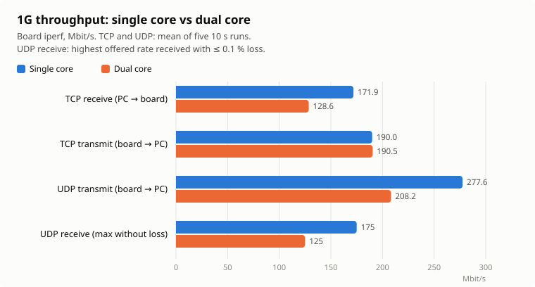
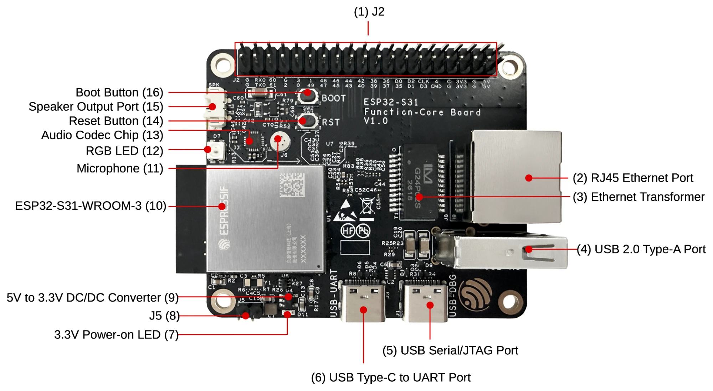
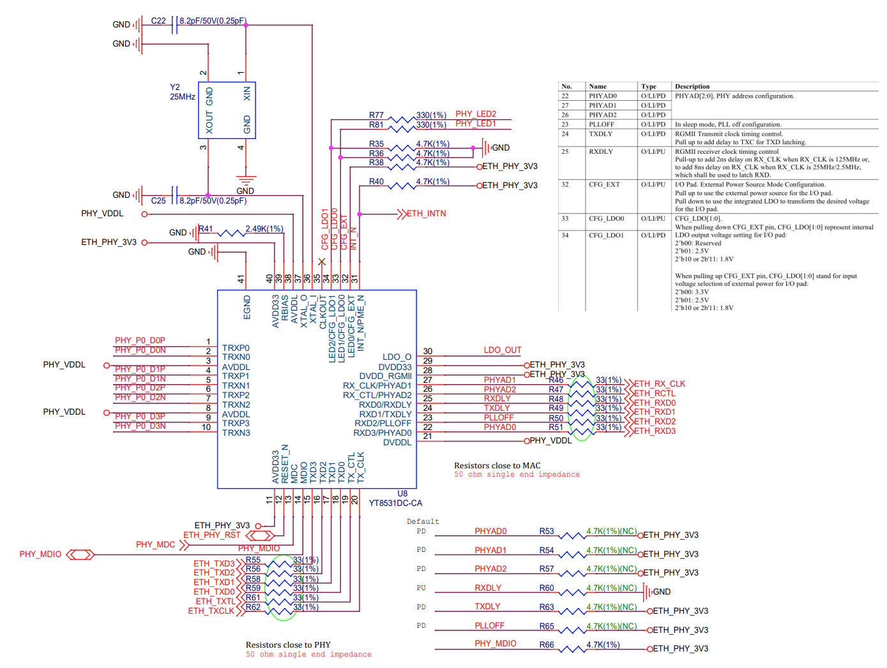
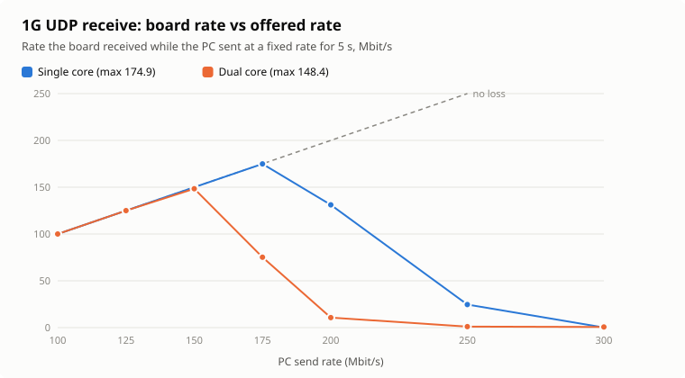
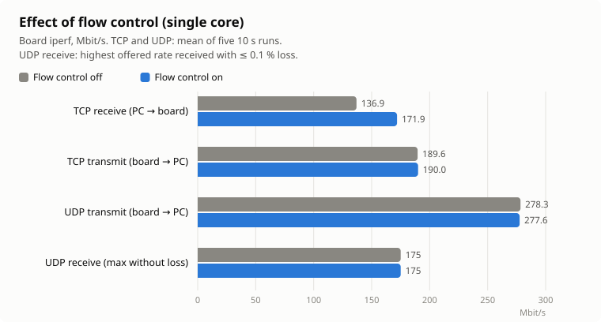

[한국어](README.md) | **English**

# ESP32-S31 1G Ethernet iperf Test Firmware

Firmware for checking the Gigabit Ethernet (internal EMAC, RGMII, YT8531 PHY) of the ESP32-S31-Function-CoreBoard-1.
It is based on `examples/ethernet/iperf` from ESP-IDF v6.1.

- **Web flasher:** <https://firepooh.github.io/esp32s31-eth1g-iperf/> (desktop Chrome/Edge: connect the USB-UART port, then **Connect** → **Flash**)
- **Binaries:** [Releases](https://github.com/firepooh/esp32s31-eth1g-iperf/releases)

## Results Summary

Measured on a 1G link with single-core and dual-core builds (2026-11-11, flow control on).



| Test | Single core | Dual core | Difference |
|---|---:|---:|---:|
| TCP receive (PC → board) | **171.9** | **128.6** | −25 % |
| TCP transmit (board → PC) | **190.0** | **190.5** | same |
| UDP transmit (board → PC) | **277.6** | **208.2** | −25 % |
| UDP receive, highest offered rate received without loss | **175** | **125** | −29 % |

Units are Mbit/s, mean of five 10 s runs.
That is 13–29 % of the theoretical 1G line rate (TCP 949, UDP 957 Mbit/s); the bottleneck is the board's CPU and network stack.

1. **Single core gives the highest throughput.** Build with `CONFIG_FREERTOS_UNICORE=y` to measure the maximum.
2. **Dual core is slower.** TCP receive and UDP transmit/receive drop by 25–29 %; only TCP transmit is unchanged.
3. **Use the dual-core figures for product design.** Most applications run with both cores enabled.
   This repository builds dual core by default.
4. **Flow control must be on, or TCP receive stalls.** With it off, TCP receive stops for 1–4 s at a time. The firmware turns it on at boot.

## Board



| Item | Details |
|---|---|
| Board | [ESP32-S31-Function-CoreBoard-1](https://docs.espressif.com/projects/esp-dev-kits/en/latest/esp32s31/esp32-s31-function-coreboard-1/index.html), ESP32-S31-WROOM-3 (16 MB flash, 16 MB PSRAM) |
| Ethernet | (2) RJ45, Motorcomm YT8531 PHY (MDIO address 0), 10/100/1000 Mbps auto-negotiation |
| Console | (6) USB-UART port, UART0 at 115200 bps. Also used for flashing (e.g. COM20) |
| Secondary log | (5) USB-DBG port (USB Serial/JTAG, output only) |
| Pins | MDC 5, MDIO 6, PHY reset 7 / TXC 13, TX_CTL 12, TXD0~3 8~11 / RXC 14, RX_CTL 15, RXD0~3 19, 18, 17, 16 |

The pin map is the IDF v6.1 default (`ETH_ESP32_EMAC_DEFAULT_CONFIG`).
The firmware re-enables auto-negotiation, which the YT8531 turns off after reset, and sets the RGMII TX/RX clock delays to about 2 ns.

<details>
<summary>YT8531 PHY schematic</summary>



- 25 MHz crystal. RX signals have 33 Ω series resistors near the MAC, TX signals near the PHY.
- The RX-pin strap resistors are not populated, so the internal defaults apply: PHY address 0, RX delay on, TX delay off.
- CFG_EXT is pulled up and CFG_LDO[1:0] pulled down, giving 3.3 V I/O.

</details>

## Build and Flash

```powershell
. C:\Espressif\tools\Microsoft.v6.1.PowerShell_profile.ps1
$env:ESPPORT = "COM20"
idf.py --preview build flash monitor
```

- The S31 is a preview target, so `--preview` is required. The DTR/RTS auto-reset circuit enters download mode.
- If `ESPPORT` points to another port, it conflicts with `-p`, so set it directly as above.
- After editing `sdkconfig.defaults`, delete `sdkconfig` and rebuild.
  Release builds use the repository's `sdkconfig`, so commit it as well.
- Pushing a `v*` tag makes GitHub Actions build the firmware and update the release and the web flasher.

### Performance Settings

| Setting | Value | Notes |
|---|---|---|
| CPU | 320 MHz | S31 maximum |
| Cores | Dual core (`CONFIG_FREERTOS_UNICORE=n`) | Single core (`=y`) is up to 29 % faster |
| Flash | QIO 80 MHz | TCP transmit about 8 % faster than DIO |
| IRAM optimization | FreeRTOS, lwIP, EMAC | Hot code runs from internal RAM |
| Flow control | On (`CONFIG_ETH_SOFT_FLOW_CONTROL=y`, enabled in `eth_s31_init()`) | Prevents TCP receive stalls. Needs a link partner that supports pause |

Switch cores with `idf.py menuconfig` → FreeRTOS → Kernel → **Run FreeRTOS only on first core**.

## Console Commands

| Command | Description |
|---|---|
| `ethernet info` | Link state, speed, IP |
| `ethernet phy` | Decoded PHY registers (1000BASE-T status, idle error count) |
| `ethernet speed auto` / `100` | Advertise up to 1G or up to 100M only, then renegotiate |
| `ethernet ip <addr> <mask> [gw]` / `dhcp` | Static IP or DHCP |
| `ethernet stats` | RX frames dropped by the EMAC (cleared on read) and flow control state |
| `ethernet flowctrl on` / `off` | Turn flow control on or off and renegotiate |
| `iperf ...` | Throughput test (iperf 2.x compatible) |

The board gets its address over DHCP at boot.
If there is no reply within 15 s of link-up, it falls back to the static IP `192.168.10.10/24` (configurable in `idf.py menuconfig`).

**1G link criteria:** the link counts as a real 1G link when all of the following hold.

- `LINK UP: 1000 Mbps` is printed and the PHY and MAC speeds agree.
- `ethernet phy` shows `local_rx=OK, remote_rx=OK`. If it shows `NOK` right after link-up, read again a few seconds later.
- The idle error count is 0 after iperf, and TCP throughput exceeds 100 Mbps.

If the link partner supports 1G but the link drops to 100M, suspect a broken pair on cable pins 4-5 or 7-8.

## iperf Measurement

The PC side uses iperf 2.x (not compatible with iperf3).
Without iperf 2.x, use [`tools/netpeer.py`](tools/netpeer.py).

| Test | Board console | PC (iperf 2.x) |
|---|---|---|
| TCP receive | `iperf -s -i 1` | `iperf -c <board IP> -t 10 -i 1` |
| TCP transmit | `iperf -c <PC IP> -t 10 -i 1` | `iperf -s -i 1` |
| UDP receive | `iperf -u -s -i 1` | `iperf -u -c <board IP> -b 150M -t 10 -i 1` |
| UDP transmit | `iperf -u -c <PC IP> -t 10 -i 1` | `iperf -u -s -i 1` |

For UDP receive, sending above the board's limit (175 Mbit/s single core, 125 Mbit/s dual core) leaves the board receiving almost nothing.

## 1G Results (2026-11-11)

- **Setup:** 1000 Mbps full duplex through a switch that supports 1000BASE-T and pause. PC: Windows 11 at 1 Gbps.
- **Conditions:** Single and dual core differ only in `CONFIG_FREERTOS_UNICORE`. Flow control on.
- **Method:** Automated with [`tools/bench.py`](tools/bench.py). TCP both ways and UDP transmit: 5 × 10 s; UDP receive: 5 s per rate.
  Throughput comes from the board's iperf output. Raw data is in [`docs/results`](docs/results).
- The idle error count was 0 after the tests, and UDP transmit always delivered everything that was sent.

### UDP Receive by Offered Rate



| PC send rate | 100 | 125 | 150 | 175 | 200 | 250 | 300 |
|---|---:|---:|---:|---:|---:|---:|---:|
| Single core received | 100.0 | 125.0 | 150.0 | 174.9 | 131.2 | 24.6 | 0.1 |
| Dual core received | 100.0 | 125.0 | 148.4 | 75.2 | 10.7 | 1.1 | 0.7 |

- Above the board's limit, reception collapses to almost zero. Flow control does not change this.
- The same happens on dual core while the iperf task runs normally on the other core,
  so packets seem to be dropped in the EMAC driver or the lwIP receive path before reaching iperf. The cause is not yet confirmed.

### TCP Receive Stalls: Cause and Fix

With flow control off, TCP receive runs at about 172 Mbit/s but now and then drops to almost zero for 1–4 s.

**Cause**

1. The PC sends a full TCP window (64 KB, about 44 packets) at 1 Gbps in one burst.
   When the board's RX DMA ring (30 buffers, the maximum) overflows, the EMAC drops frames.
2. lwIP keeps only 4 out-of-order segments and sends no SACK,
   so losing a few frames forces the PC to resend most of the window, and retransmission timeouts add up to stalls of several seconds.

**Experiment** (single core, 6 × 10 s TCP receive runs per condition)

| Condition | Stalled time | Frames dropped by EMAC | PC retransmissions | 10 s average |
|---|---:|---:|---:|---:|
| Flow control off | 13 s | 40 | 573 | 112.6 ~ 172.2 |
| Flow control off, 20 RX buffers | 24 s | 213 | 1598 | 53.4 ~ 118.1 |
| **Flow control on** | **0 s** | **0** | **0** | **172.1 ~ 172.4** |
| Flow control off, 16-segment TCP window | 0 s | 0 | 11 | 166.8 ~ 170.2 |

**Fix: turn on flow control**



| Test | Single core off → on | Dual core off → on |
|---|---:|---:|
| TCP receive, 10 s average | 136.9 → **171.9** | 104.6 → **128.6** |
| TCP receive stalls (out of 5 runs) | 4 → **0** | 3 → **0** |
| TCP transmit, UDP transmit/receive | unchanged | unchanged |

- When fewer than a third of the RX buffers are free, the board sends pause frames and the switch briefly holds its traffic.
- The link partner must support pause (`partner=1` in `ethernet stats`).
  If it does not, set `CONFIG_LWIP_TCP_WND_DEFAULT=23360` (16 segments); TCP receive then runs at about 169 Mbit/s.

### Other Findings

- **Multiple streams:** TCP transmit tops out at about 190 Mbit/s regardless of streams or cores.
  Only dual-core TCP receive rises with 2 connections, to 162.8 Mbit/s (128.6 with one).
- **Why dual core is slower (presumed):** Transmit and receive funnel through a single lwIP `tcpip` task, so a second core has little to take over and only adds locking and cache overhead.
- **QIO flash:** TCP transmit rose from 176.5 to 190.0 Mbit/s compared with DIO.
- **Other MCUs:** An i.MX RT1170 (996 MHz) running its code from QSPI flash reaches 108–120 Mbit/s TCP ([emb4fun](https://www.emb4fun.de/projects/lwip1160poc/index.html)).
  The S31 matches or beats that at a third of the clock.

## 100M Results (2026-11-10)

The link partner was 100M-only, so the link came up at 100 Mbps. All four directions reached the theoretical line rate.

| Test | TCP receive | TCP transmit | UDP receive | UDP transmit |
|---|---:|---:|---:|---:|
| Board (Mbit/s) | 94.84 | 94.91 | 95.62 | 95.73 |
| Theoretical limit (Mbit/s) | 94.93 | 94.93 | 95.70 | 95.70 |

The limits come from the bytes each frame occupies on the wire (TCP 1538 B, UDP 1536 B); at 1G they are TCP 949 and UDP 957 Mbit/s.

## Measurement Tools

iperf 2.x was not installed on the PC, so these Python scripts were written. They run as-is in ESP-IDF's Python environment.

| File | Purpose |
|---|---|
| [`tools/netpeer.py`](tools/netpeer.py) | Sends or receives TCP/UDP traffic the way iperf 2.x does |
| [`tools/bench.py`](tools/bench.py) | Drives the board console (UART) and `netpeer.py` together, runs the full suite and saves JSON |
| [`tools/plot_results.py`](tools/plot_results.py) | Draws the result charts from the JSON (Korean `*.svg`, English `*.en.svg`) |

```powershell
python tools\bench.py --port COM20 --board 192.168.0.71 --pc 192.168.0.12 --label dual-core --out docs\results\1g-dual-core.json
python tools\plot_results.py
```

- `bench.py` resets the board when it starts. Close any terminal holding the COM port first.
- `--flowctrl on|off` changes flow control for the run; `--only tcp_tx udp_tx` re-runs just those tests.

## Sources and Licenses

- `main/ethernet_iperf_main.c`, `main/cmd_ethernet.c`: modified from ESP-IDF `examples/ethernet/iperf` (Unlicense or CC0-1.0)
- YT8531 init in `main/eth_s31.c`: follows ESP-IDF `examples/ethernet/basic` (Apache-2.0)
- `components/cmd_system`: copied from ESP-IDF `examples/system/console/advanced` (Unlicense or CC0-1.0)
- `web/index.html`: loads [esptool-js](https://github.com/espressif/esptool-js) 0.7.1 from a CDN
- The board photo and PHY schematic in `docs/images` come from Espressif's public documentation. The result charts are generated by `tools/plot_results.py`
