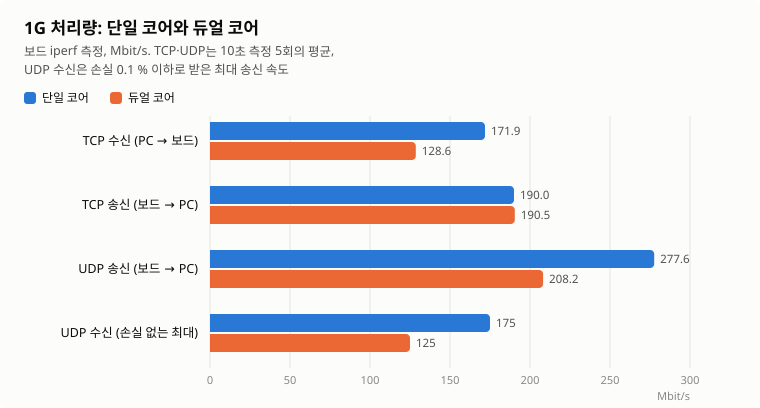
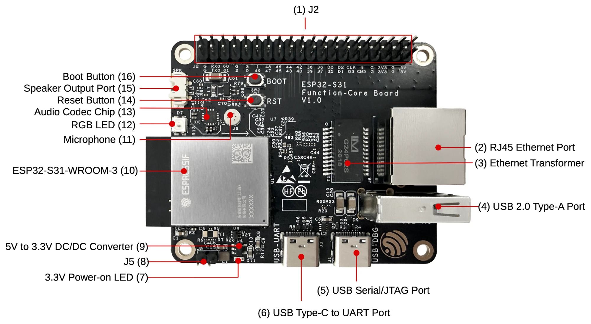
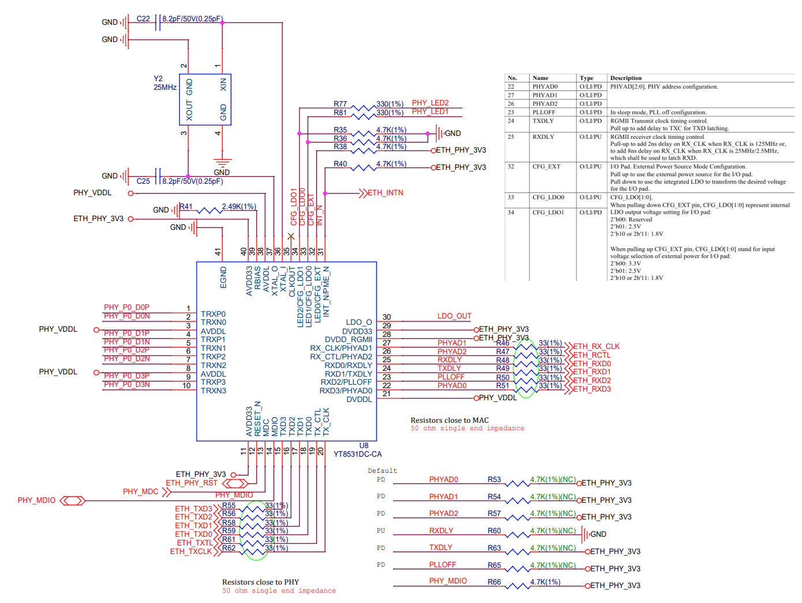
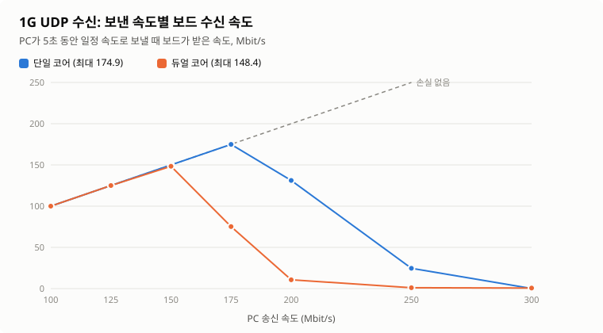
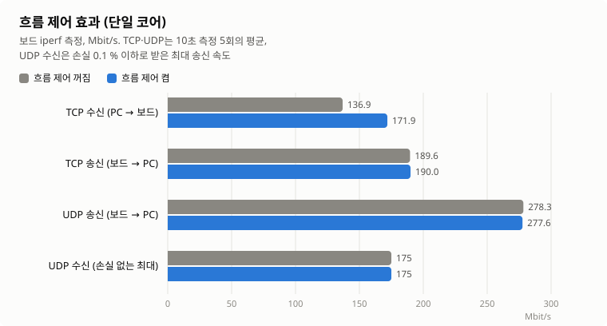

**한국어** | [English](README.en.md)

# ESP32-S31 1G Ethernet iperf 테스트 펌웨어

ESP32-S31-Function-CoreBoard-1의 기가비트 이더넷(내장 EMAC, RGMII, YT8531 PHY)을 점검하는 펌웨어다.
ESP-IDF v6.1의 `examples/ethernet/iperf`를 바탕으로 만들었다.

- **웹 플래셔:** <https://firepooh.github.io/esp32s31-eth1g-iperf/> (데스크톱 Chrome/Edge에서 USB-UART 포트를 연결하고 **연결** → **플래시**)
- **바이너리:** [Releases](https://github.com/firepooh/esp32s31-eth1g-iperf/releases)

## 측정 결과 요약

1G 링크에서 단일 코어와 듀얼 코어로 측정했다(2026-11-11, 흐름 제어 켬).



| 시험 | 단일 코어 | 듀얼 코어 | 차이 |
|---|---:|---:|---:|
| TCP 수신 (PC → 보드) | **171.9** | **128.6** | −25 % |
| TCP 송신 (보드 → PC) | **190.0** | **190.5** | 같음 |
| UDP 송신 (보드 → PC) | **277.6** | **208.2** | −25 % |
| UDP 수신, 손실 없이 받는 최대 송신 속도 | **175** | **125** | −29 % |

단위는 Mbit/s이고, 10초 측정 5회의 평균이다.
1G 회선 이론 한계(TCP 949, UDP 957 Mbit/s)의 13~29 % 수준으로, 병목은 보드의 CPU와 네트워크 스택이다.

1. **최대 성능은 단일 코어에서 나온다.** 최대 성능을 잴 때는 `CONFIG_FREERTOS_UNICORE=y`로 빌드한다.
2. **듀얼 코어에서는 성능이 떨어진다.** TCP 수신, UDP 송수신이 25~29 % 낮고, TCP 송신만 같다.
3. **제품 설계에는 듀얼 코어 값을 기준으로 삼는다.** 대부분의 애플리케이션은 두 코어를 모두 쓴다.
   이 저장소의 기본 설정도 듀얼 코어다.
4. **흐름 제어를 켜야 TCP 수신이 끊기지 않는다.** 끄면 1~4초씩 멈춘다. 펌웨어는 부팅 때 흐름 제어를 켠다.

## 보드



| 항목 | 내용 |
|---|---|
| 보드 | [ESP32-S31-Function-CoreBoard-1](https://docs.espressif.com/projects/esp-dev-kits/en/latest/esp32s31/esp32-s31-function-coreboard-1/index.html), ESP32-S31-WROOM-3 (플래시 16 MB, PSRAM 16 MB) |
| 이더넷 | (2) RJ45, Motorcomm YT8531 PHY (MDIO 주소 0), 10/100/1000 Mbps 자동 협상 |
| 콘솔 | (6) USB-UART 포트, UART0 115200 bps. 플래시도 이 포트로 한다 (예: COM20) |
| 보조 로그 | (5) USB-DBG 포트 (USB Serial/JTAG, 출력 전용) |
| 핀 | MDC 5, MDIO 6, PHY 리셋 7 / TXC 13, TX_CTL 12, TXD0~3 8~11 / RXC 14, RX_CTL 15, RXD0~3 19, 18, 17, 16 |

핀 배치는 IDF v6.1 기본값(`ETH_ESP32_EMAC_DEFAULT_CONFIG`)이다.
펌웨어는 YT8531이 리셋 뒤 끄는 자동 협상을 다시 켜고, RGMII TX/RX 클록 지연을 약 2 ns로 설정한다.

<details>
<summary>YT8531 PHY 회로도</summary>



- 25 MHz 수정 진동자. RX 신호는 MAC 쪽, TX 신호는 PHY 쪽에 33 Ω 직렬 저항이 있다.
- RX 핀 스트랩 저항은 미실장이라 내부 기본값을 따른다: PHY 주소 0, RX 지연 켬, TX 지연 끔.
- CFG_EXT 풀업, CFG_LDO[1:0] 풀다운으로 I/O 전압은 3.3 V다.

</details>

## 빌드와 플래시

```powershell
. C:\Espressif\tools\Microsoft.v6.1.PowerShell_profile.ps1
$env:ESPPORT = "COM20"
idf.py --preview build flash monitor
```

- S31은 프리뷰 타깃이라 `--preview`가 필요하다. 다운로드 모드는 DTR/RTS 자동 리셋으로 들어간다.
- `ESPPORT`가 다른 포트로 잡혀 있으면 `-p`와 충돌하므로 위처럼 직접 지정한다.
- `sdkconfig.defaults`를 고치면 `sdkconfig`를 지우고 다시 빌드한다.
  릴리즈 빌드는 저장소의 `sdkconfig`를 쓰므로 함께 커밋한다.
- `v*` 태그를 푸시하면 GitHub Actions가 빌드해 릴리즈와 웹 플래셔를 갱신한다.

### 성능 관련 설정

| 설정 | 값 | 비고 |
|---|---|---|
| CPU | 320 MHz | S31 최댓값 |
| 코어 | 듀얼 코어 (`CONFIG_FREERTOS_UNICORE=n`) | 단일 코어(`=y`)로 바꾸면 최대 29 % 빠르다 |
| 플래시 | QIO 80 MHz | DIO보다 TCP 송신이 약 8 % 빠르다 |
| IRAM 최적화 | FreeRTOS, lwIP, EMAC | 자주 실행되는 코드를 내부 RAM에서 실행한다 |
| 흐름 제어 | 켬 (`CONFIG_ETH_SOFT_FLOW_CONTROL=y`, `eth_s31_init()`에서 켬) | TCP 수신 끊김을 막는다. 상대 장비가 pause를 지원해야 한다 |

코어 설정은 `idf.py menuconfig` → FreeRTOS → Kernel → **Run FreeRTOS only on first core**로 바꾼다.

## 콘솔 명령

| 명령 | 설명 |
|---|---|
| `ethernet info` | 링크 상태, 속도, IP |
| `ethernet phy` | PHY 레지스터 해석 (1000BASE-T 상태, idle error 수) |
| `ethernet speed auto` / `100` | 1G까지 또는 100M까지만 광고하고 재협상 |
| `ethernet ip <addr> <mask> [gw]` / `dhcp` | 고정 IP 또는 DHCP |
| `ethernet stats` | EMAC가 버린 수신 프레임 수(읽으면 초기화)와 흐름 제어 상태 |
| `ethernet flowctrl on` / `off` | 흐름 제어를 켜거나 끄고 재협상 |
| `iperf ...` | 처리량 측정 (iperf 2.x 호환) |

부팅하면 DHCP로 주소를 받는다.
링크 후 15초 안에 응답이 없으면 고정 IP `192.168.10.10/24`로 바꾼다(`idf.py menuconfig`에서 변경).

**1G 연결 판정:** 다음을 모두 만족하면 실제 1G 연결로 본다.

- `LINK UP: 1000 Mbps`가 출력되고, PHY와 MAC 속도가 같다.
- `ethernet phy`에서 `local_rx=OK, remote_rx=OK`다. 링크 직후 `NOK`이면 몇 초 뒤 다시 읽는다.
- iperf 측정 뒤 idle error가 0이고, TCP 처리량이 100 Mbps를 넘는다.

상대 장비가 1G를 지원하는데 100M로 떨어지면 케이블의 4-5번이나 7-8번 페어 단선을 의심한다.

## iperf 측정

PC 쪽은 iperf 2.x를 쓴다(iperf3와 호환되지 않음).
iperf 2.x가 없으면 [`tools/netpeer.py`](tools/netpeer.py)를 쓴다.

| 시험 | 보드 콘솔 | PC (iperf 2.x) |
|---|---|---|
| TCP 수신 | `iperf -s -i 1` | `iperf -c <보드 IP> -t 10 -i 1` |
| TCP 송신 | `iperf -c <PC IP> -t 10 -i 1` | `iperf -s -i 1` |
| UDP 수신 | `iperf -u -s -i 1` | `iperf -u -c <보드 IP> -b 150M -t 10 -i 1` |
| UDP 송신 | `iperf -u -c <PC IP> -t 10 -i 1` | `iperf -u -s -i 1` |

UDP 수신은 보드 한계(단일 코어 175, 듀얼 코어 125 Mbit/s)를 넘겨 보내면 보드가 거의 받지 못한다.

## 1G 측정 결과 (2026-11-11)

- **환경:** 1000 Mbps 전이중, 스위치 경유. 상대 장비는 1000BASE-T와 pause를 지원한다. PC는 Windows 11, 1 Gbps.
- **조건:** 단일 코어와 듀얼 코어는 `CONFIG_FREERTOS_UNICORE`만 다르다. 흐름 제어는 켰다.
- **방법:** [`tools/bench.py`](tools/bench.py)로 자동 측정했다. TCP 송수신과 UDP 송신은 10초 × 5회, UDP 수신은 속도별 5초.
  처리량은 보드 iperf 출력값이다. 원본은 [`docs/results`](docs/results)에 있다.
- 시험 뒤 idle error는 0이었고, UDP 송신은 보낸 양과 받은 양이 매번 같았다.

### UDP 수신: 보낸 속도별 결과



| PC 송신 속도 | 100 | 125 | 150 | 175 | 200 | 250 | 300 |
|---|---:|---:|---:|---:|---:|---:|---:|
| 단일 코어 수신 | 100.0 | 125.0 | 150.0 | 174.9 | 131.2 | 24.6 | 0.1 |
| 듀얼 코어 수신 | 100.0 | 125.0 | 148.4 | 75.2 | 10.7 | 1.1 | 0.7 |

- 보드 한계를 넘기면 수신량이 0에 가깝게 떨어진다. 흐름 제어를 켜도 같다.
- 듀얼 코어에서 iperf 태스크가 다른 코어에서 정상 동작할 때도 같았다.
  따라서 패킷이 iperf에 닿기 전에 EMAC 드라이버나 lwIP 수신 경로에서 버려지는 것으로 보인다. 원인은 아직 확인하지 않았다.

### TCP 수신 끊김: 원인과 해결

흐름 제어가 꺼져 있으면 TCP 수신이 약 172 Mbit/s로 흐르다가 이따금 1~4초 동안 거의 0으로 떨어진다.

**원인**

1. PC는 TCP 윈도(64 KB, 약 44개 패킷)를 1 Gbps로 한꺼번에 보낸다.
   보드의 수신 DMA 버퍼(30개, 최댓값)가 넘치면 EMAC가 프레임을 버린다.
2. lwIP는 순서가 어긋난 세그먼트를 4개만 보관하고 SACK도 없다.
   그래서 몇 개만 잃어도 PC가 대부분을 다시 보내야 하고, 재전송 대기가 겹쳐 몇 초씩 멈춘다.

**확인 실험** (단일 코어, 조건마다 TCP 수신 10초 × 6회)

| 조건 | 끊긴 시간 | EMAC가 버린 프레임 | PC 재전송 | 10초 평균 |
|---|---:|---:|---:|---:|
| 흐름 제어 끔 | 13초 | 40 | 573 | 112.6 ~ 172.2 |
| 흐름 제어 끔, 수신 버퍼 20개 | 24초 | 213 | 1598 | 53.4 ~ 118.1 |
| **흐름 제어 켬** | **0초** | **0** | **0** | **172.1 ~ 172.4** |
| 흐름 제어 끔, TCP 윈도 16세그먼트 | 0초 | 0 | 11 | 166.8 ~ 170.2 |

**해결: 흐름 제어 켜기**



| 시험 | 단일 코어 끔 → 켬 | 듀얼 코어 끔 → 켬 |
|---|---:|---:|
| TCP 수신, 10초 평균 | 136.9 → **171.9** | 104.6 → **128.6** |
| TCP 수신 끊김 (5회 중) | 4 → **0** | 3 → **0** |
| TCP 송신, UDP 송수신 | 변화 없음 | 변화 없음 |

- 빈 수신 버퍼가 1/3 아래로 줄면 보드가 pause 프레임을 보내고, 스위치가 잠시 전송을 멈춘다.
- 상대 장비가 pause를 지원해야 한다(`ethernet stats`에서 `partner=1`).
  지원하지 않으면 `CONFIG_LWIP_TCP_WND_DEFAULT=23360`(16세그먼트)으로 줄이면 된다. TCP 수신은 약 169 Mbit/s가 된다.

### 그 밖의 결과

- **멀티 스트림:** TCP 송신은 스트림 수와 코어 수에 상관없이 약 190 Mbit/s에서 막힌다.
  듀얼 코어 TCP 수신만 연결 2개에서 162.8 Mbit/s로 올라간다(연결 1개 128.6).
- **듀얼 코어가 느린 이유(추정):** 송수신이 lwIP `tcpip` 태스크 하나로 모여 코어를 늘려도 나눌 일이 적고, 잠금과 캐시 비용만 늘어난다.
- **플래시 QIO:** DIO보다 TCP 송신이 176.5 → 190.0 Mbit/s로 올랐다.
- **다른 MCU:** i.MX RT1170(996 MHz)도 코드를 QSPI 플래시에서 실행하면 TCP 108~120 Mbit/s다([emb4fun](https://www.emb4fun.de/projects/lwip1160poc/index.html)).
  S31은 클록이 1/3인데도 비슷하거나 높다.

## 100M 측정 결과 (2026-11-10)

상대 장비가 100M 전용이라 100 Mbps로 연결됐다. 네 방향 모두 회선 이론 한계에 도달했다.

| 시험 | TCP 수신 | TCP 송신 | UDP 수신 | UDP 송신 |
|---|---:|---:|---:|---:|
| 보드 측정 (Mbit/s) | 94.84 | 94.91 | 95.62 | 95.73 |
| 이론 한계 (Mbit/s) | 94.93 | 94.93 | 95.70 | 95.70 |

이론 한계는 프레임당 회선 점유(TCP 1538 B, UDP 1536 B)로 계산했다. 1G 기준으로는 TCP 949, UDP 957 Mbit/s다.

## 측정 도구

PC에 iperf 2.x가 없어 Python 스크립트를 만들었다. ESP-IDF의 Python 환경에서 바로 돌아간다.

| 파일 | 하는 일 |
|---|---|
| [`tools/netpeer.py`](tools/netpeer.py) | iperf 2.x 방식으로 TCP/UDP 트래픽을 보내거나 받는다 |
| [`tools/bench.py`](tools/bench.py) | 보드 콘솔(UART)과 `netpeer.py`를 함께 제어해 전체 시험을 돌리고 JSON으로 저장한다 |
| [`tools/plot_results.py`](tools/plot_results.py) | JSON으로 결과 그래프를 그린다 (한국어 `*.svg`, 영어 `*.en.svg`) |

```powershell
python tools\bench.py --port COM20 --board 192.168.0.71 --pc 192.168.0.12 --label dual-core --out docs\results\1g-dual-core.json
python tools\plot_results.py
```

- `bench.py`는 시작할 때 보드를 리셋한다. COM 포트를 잡고 있는 터미널은 먼저 닫는다.
- `--flowctrl on|off`로 흐름 제어를 바꾸고, `--only tcp_tx udp_tx`처럼 일부 시험만 다시 돌릴 수 있다.

## 출처와 라이선스

- `main/ethernet_iperf_main.c`, `main/cmd_ethernet.c`: ESP-IDF `examples/ethernet/iperf` 수정 (Unlicense 또는 CC0-1.0)
- `main/eth_s31.c`의 YT8531 초기화: ESP-IDF `examples/ethernet/basic` 참고 (Apache-2.0)
- `components/cmd_system`: ESP-IDF `examples/system/console/advanced` 복사 (Unlicense 또는 CC0-1.0)
- `web/index.html`: [esptool-js](https://github.com/espressif/esptool-js) 0.7.1을 CDN에서 불러 쓴다
- `docs/images`의 보드 사진과 PHY 회로도는 Espressif 공개 자료에서 가져왔다. 결과 그래프는 `tools/plot_results.py`로 만들었다
